<p align="center">
  
</p>

<p align="center">
  <a href="https://huggingface.co/spaces/CarolBonk/Quantum_Portfolio_Optimizer"></a>
  
  
</p>

Pick the highest-return basket of stocks with QAOA while Black-Scholes call deltas keep options exposure under a cap.

- **QAOA on Qiskit Aer:** a Dicke start state and XY mixer keep exactly *k* stocks selected; the delta cap is a QUBO penalty with slack qubits.
- **Exact check:** every answer is compared with an exhaustive classical search.
- **Custom dashboard:** FastAPI backend, vanilla HTML/CSS/JS frontend and Plotly charts. Runs on the Hugging Face free CPU tier (up to 8 assets).

## Run locally

```bash
pip install -r requirements.txt "gradio[oauth,mcp]==6.32.0"  # gradio brings fastapi, uvicorn and pydantic
python app.py  # http://localhost:7860
```

Data is illustrative, not live market data, and nothing here is investment advice.

Built by **CarolBonk**.
